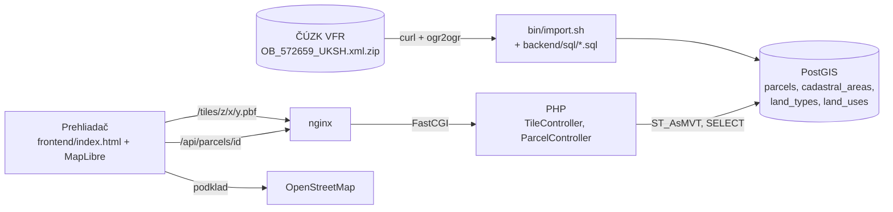

# Mapa parciel okresu Jičín

Webová aplikácia, ktorá zobrazí parcely na mape a po kliknutí na parcelu ukáže jej detail: číslo, katastrálne územie, výmeru, druh pozemku, spôsob využitia a odkaz do Nahlížení do KN.

**Rozsah:** 5 katastrálnych území obce Jičín (Jičín, Popovice u Jičína, Robousy, Moravčice, Hubálov), spolu 16 950 parciel. Zadanie vyžaduje KÚ Jičín a aspoň 3 ďalšie. Prečo nie celý okres, je opísané v [ADR-0004](docs/adr.md#adr-0004-rozsah-5-katastrálnych-území-obce-jičín).

Navyše oproti zadaniu: parcely sú zafarbené podľa druhu pozemku, legenda vie jednotlivé druhy vypnúť a detail obsahuje priamy odkaz do Nahlížení do KN.

## Spustenie

**Predpoklady:** Docker s Compose v2, `bash` a `curl` (macOS alebo Linux), voľné porty 8080 a 5433 a internet (sťahovanie dát z ČÚZK, MapLibre z CDN a podklad OSM). Lokálne PHP ani Node netreba, všetko beží v kontajneroch:

| Služba | Verzia |
|---|---|
| PHP-FPM | 8.3 (`pdo_pgsql`, GDAL 3.10 pre import) |
| PostgreSQL + PostGIS | 17 + 3.5 (`imresamu/postgis`, multi-arch aj pre Apple Silicon) |
| nginx | 1.27 |
| MapLibre GL JS | 4.7.1 (z unpkg) |

```bash
cp .env.example .env
docker compose up -d --build
docker compose exec php composer install
bin/import.sh
```

Potom otvor <http://localhost:8080>. `bin/import.sh` stiahne súbor obce z ČÚZK (3,7 MB) do `backend/var/data/` a naplní databázu za pár sekúnd. Dá sa spustiť opakovane.

Kontroly kódu:

```bash
docker compose exec php composer phpstan
docker compose exec php composer test
```

## Ako to funguje



- **Dáta** sú predom stiahnuté z výmenného formátu RÚIAN (VFR), nie načítavané live z WFS. Import ich transformuje do Web Mercator (EPSG:3857), aby sa pri každej dlaždici nemuseli prepočítavať.
- **Mapa** používa vektorové dlaždice (Mapbox Vector Tiles), ktoré PostGIS generuje funkciou `ST_AsMVT`. Prehliadač teda dostane len parcely vo výreze a s presnosťou zodpovedajúcou zoomu. Geometria je zjednodušená na 1 obrazovkový pixel.
- **PHP** je čisté PHP 8.3 bez frameworku: vlastný router, centrálne spracovanie chýb ako JSON, ručná DI v [Application.php](backend/src/Application.php) a SQL v repozitári cez prepared statements.

| Endpoint | Odpoveď |
|---|---|
| `GET /tiles/{z}/{x}/{y}.pbf` | MVT s vrstvami `areas` (hranice KÚ) a `parcels` (`id`, `land_type`), 204 pre prázdnu dlaždicu |
| `GET /api/parcels/{id}` | JSON s detailom parcely, 404 ak neexistuje |
| `GET /api/health` | stav aplikácie a verzia PostGIS |

```
bin/import.sh                 import dát (curl → ogr2ogr → SQL)
backend/sql/                  číselníky a stavba tabuliek
backend/src/Http/             router, request/response, spracovanie chýb
backend/src/Controller/       Tile, Parcel, Health
backend/src/Repository/       ParcelRepository (SQL)
frontend/index.html           celý frontend
docs/adr.md                   rozhodnutia (ADR-0001 až ADR-0015)
```
