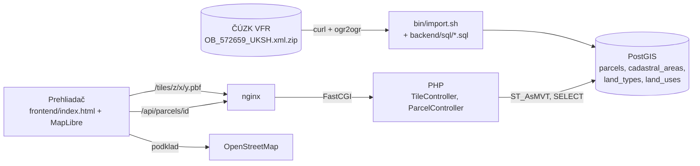

# Mapa parciel okresu Jičín

Webová aplikácia, ktorá zobrazí parcely na mape a po kliknutí na parcelu ukáže jej detail: číslo, katastrálne územie, výmeru, druh pozemku, spôsob využitia a odkaz do Nahlížení do KN.

**Rozsah:** 5 katastrálnych území obce Jičín (Jičín, Popovice u Jičína, Robousy, Moravčice, Hubálov), spolu 16 950 parciel. Zadanie vyžaduje KÚ Jičín a aspoň 3 ďalšie. Prečo nie celý okres, je opísané v [ADR-0004](docs/adr.md#adr-0004-rozsah-5-katastrálnych-území-obce-jičín).

Navyše oproti zadaniu: parcely sú zafarbené podľa druhu pozemku, legenda vie jednotlivé druhy vypnúť a detail obsahuje priamy odkaz do Nahlížení do KN.

## Spustenie

**Predpoklady:** Docker s Compose v2, `bash` a `curl` (macOS alebo Linux), voľné porty 8080 a 5433 a internet (sťahovanie dát z ČÚZK, MapLibre z CDN a podklad OSM). Lokálne PHP ani Node netreba, všetko beží v kontajneroch:

| Služba | Verzia |
|---|---|
| PHP-FPM | 8.3 (`pdo_pgsql`, GDAL 3.10 pre import) |
| PostgreSQL + PostGIS | 17 + 3.5 (`imresamu/postgis`, multi-arch aj pre Apple Silicon) |
| nginx | 1.27 |
| MapLibre GL JS | 4.7.1 (z unpkg) |

```bash
cp .env.example .env
docker compose up -d --build
docker compose exec php composer install
bin/import.sh
```

Potom otvor <http://localhost:8080>. `bin/import.sh` stiahne súbor obce z ČÚZK (3,7 MB) do `backend/var/data/` a naplní databázu za pár sekúnd. Dá sa spustiť opakovane.

Kontroly kódu:

```bash
docker compose exec php composer phpstan
docker compose exec php composer test
```

## Ako to funguje



- **Dáta** sú predom stiahnuté z výmenného formátu RÚIAN (VFR), nie načítavané live z WFS. Import ich transformuje do Web Mercator (EPSG:3857), aby sa pri každej dlaždici nemuseli prepočítavať.
- **Mapa** používa vektorové dlaždice (Mapbox Vector Tiles), ktoré PostGIS generuje funkciou `ST_AsMVT`. Prehliadač teda dostane len parcely vo výreze a s presnosťou zodpovedajúcou zoomu. Geometria je zjednodušená na 1 obrazovkový pixel.
- **PHP** je čisté PHP 8.3 bez frameworku: vlastný router, centrálne spracovanie chýb ako JSON, ručná DI v [Application.php](backend/src/Application.php) a SQL v repozitári cez prepared statements.

| Endpoint | Odpoveď |
|---|---|
| `GET /tiles/{z}/{x}/{y}.pbf` | MVT s vrstvami `areas` (hranice KÚ) a `parcels` (`id`, `land_type`), 204 pre prázdnu dlaždicu |
| `GET /api/parcels/{id}` | JSON s detailom parcely, 404 ak neexistuje |
| `GET /api/health` | stav aplikácie a verzia PostGIS |

```
bin/import.sh                 import dát (curl → ogr2ogr → SQL)
backend/sql/                  číselníky a stavba tabuliek
backend/src/Http/             router, request/response, spracovanie chýb
backend/src/Controller/       Tile, Parcel, Health
backend/src/Repository/       ParcelRepository (SQL)
frontend/index.html           celý frontend
docs/adr.md                   rozhodnutia (ADR-0001 až ADR-0015)
docs/navrh.md, docs/postup.md návrh riešenia a postup krok po kroku
```

## Zápisník

### Postup

Najprv som spísal návrh a plán krokov, postavil Docker prostredie a HTTP vrstvu v PHP a preskúmal dáta VFR. Na základe prieskumu som zvolil rozsah 5 KÚ obce Jičín, ktorý splní povinné minimum s rezervou, a riešenie som držal čo najjednoduchšie. Návrh ([docs/navrh.md](docs/navrh.md)) a postup ([docs/postup.md](docs/postup.md)) popisujú výsledné riešenie a každé rozhodnutie aj s alternatívami je v [docs/adr.md](docs/adr.md).

### Hlavné rozhodnutia

| Otázka | Rozhodnutie | Prečo | ADR |
|---|---|---|---|
| Live z WFS, alebo stiahnuť? | Stiahnuť VFR a importovať do PostGIS | WFS je pomalé a obmedzené počtom prvkov, plynulosť by závisela od ČÚZK | 0002 |
| Ktorý dataset? | RÚIAN VFR (`OB_<kód>_UKSH`), nie INSPIRE Cadastral Parcels | INSPIRE nemá druh pozemku ani spôsob využitia, teda práve to, čo výkupcu zaujíma | 0002 |
| Rozsah | 5 KÚ obce Jičín | Jeden súbor splní povinné minimum, celý okres by vyžadoval 111 súborov a agregáciu na malých zoomoch | 0004 |
| Import | Shell skript: `ogr2ogr` a SQL | GDAL číta GML VFR priamo, transformácia je v jednom SQL súbore | 0006 |
| Číselníky | SQL súbor vygenerovaný zo `ST_UCIS` | GDAL ich nevie načítať, sú malé a stabilné | 0007 |
| Prenos geometrie | Vektorové dlaždice z PostGIS, bez diskovej cache | Generovanie trvá 12 až 50 ms, cache by pri tomto rozsahu nepriniesla rozdiel | 0011 |
| Detail parcely | Typované pole z repozitára, bez DTO | Objekty by nenesli žiadnu logiku, PHPStan level 8 kontroluje tvar | 0012 |
| Frontend | Jeden HTML súbor s MapLibre z CDN | Bez buildu a Node, WebGL zvládne tisíce polygónov | 0013 |
| PHP | Čisté PHP, vlastný router a ručná DI | Zadanie preferuje čisté PHP, aplikácia má 3 endpointy | 0008, 0009 |
| Podklad | OpenStreetMap | Bez registrácie a API kľúča, spustí ho ktokoľvek | 0014 |
| Webserver | nginx + php-fpm | Paralelné dlaždice, `php -S` je jednovláknový | 0015 |

### Prieskum dát RÚIAN VFR (2026-10-21)

**Odkiaľ dáta sú.** Mesačné súbory VFR sú v archíve `https://services.cuzk.cz/vfr/<YYYYMM>/`. Najnovší úplný stav v archíve je `202608` (súbory z 2026-08-31). Potrebujeme tri druhy súborov:

| Súbor | Veľkosť | Obsah |
|---|---|---|
| `20260831_ST_UZSZ.xml.zip` | 4,5 MB | Základné územné prvky celej ČR (kraje, okresy, obce, KÚ) bez parciel |
| `20260803_ST_UCIS.xml.zip` | 64 kB | Číselníky (druhy pozemkov, spôsoby využitia, …) |
| `20260831_OB_<kód obce>_UKSH.xml.zip` | 3,7 MB (Jičín) | Kompletné dáta jednej obce vrátane parciel a ich hraníc |

**Okres Jičín** má v RÚIAN kód **3604**. Podľa `ST_UZSZ` (vrstva `Obce`, pole `OkresKod`) do neho patrí **111 obcí** a **240 katastrálnych území**. Obec Jičín má kód **572659** a 5 KÚ: Jičín (659541), Popovice u Jičína (725838), Robousy (740225), Moravčice (740217) a Hubálov (771775).

**Štruktúra súboru obce.** GDAL ho číta GML driverom cez vstavanú šablónu `ruian_vf_ob_v1.gfs`. Má vrstvy `Obce`, `SpravniObvody`, `Mop`, `Momc`, `CastiObci`, `KatastralniUzemi`, `Zsj`, `Ulice`, `Parcely`, `StavebniObjekty` a `AdresniMista`. Pre nás sú dôležité `Parcely` a `KatastralniUzemi`.

**Vrstva `Parcely`.** Obec Jičín má 16 950 parciel (Jičín 12 283, Robousy 2 445, Popovice 1 475, Moravčice 467, Hubálov 280). Súradnice sú v S-JTSK (EPSG:5514).

| Pole | Typ | Význam |
|---|---|---|
| `Id` | Integer64 | ID parcely, funguje aj v odkaze na Nahlížení do KN (`https://nahlizenidokn.cuzk.gov.cz/ZobrazObjekt.aspx?typ=parcela&id=<Id>`, overené) |
| `KmenoveCislo`, `PododdeleniCisla` | Integer | Parcelné číslo `820/13`; pododdelenie je `NULL`, ak parcela nie je delená |
| `DruhCislovaniKod` | Integer | 1 = stavebná („st.“), 2 = pozemková |
| `VymeraParcely` | Integer64 | Výmera v m² |
| `DruhPozemkuKod` | Integer | Druh pozemku (číselník nižšie) |
| `ZpusobyVyuzitiPozemku` | Integer | Spôsob využitia, často `NULL` |
| `KatastralniUzemiKod` | Integer | Kód KÚ |
| `BonitovanyDil*` | zoznamy | BPEJ (bonita pôdy) a výmery bonitovaných dielov, vyplnené pri 6 931 parcelách |
| geometria `DefinicniBod` | Point | Bod vnútri parcely |
| geometria `OriginalniHranice` | Polygon | Hranica parcely, vyplnená pri všetkých parcelách |
| geometria `OriginalniHraniceOmpv` | MultiPolygon | Hranica podľa „obrazu mapy s pozemkovými úpravami“, v Jičíne prázdna |

**Číselník druhov pozemkov (`ST_UCIS`):** 2 orná půda, 3 chmelnice, 4 vinice, 5 zahrada, 6 ovocný sad, 7 a 8 trvalý travní porost, 10 lesní pozemek, 11 vodní plocha, 13 zastavěná plocha a nádvoří, 14 ostatní plocha. Spôsobov využitia je 30 (napr. 16 silnice, 19 zeleň, 29 fotovoltaická elektrárna, 30 mez, stráň).

**Rozdelenie druhov v obci Jičín:** zastavená plocha 5 588, ostatná plocha 3 891, orná pôda 3 034, záhrada 2 835, TTP 876, vodná plocha 427, ovocný sad 186, les 113.

**Čo ma prekvapilo:**
- Počet stavebných parciel (5 588) presne sedí s počtom „zastavěná plocha a nádvoří“. Stavebná parcela je vždy zastavená plocha.
- Trvalý trávny porast má dva kódy (7 a 8).
- VFR obsahuje aj BPEJ, teda bonitu pôdy. To je pre výkup veľmi cenná informácia nad rámec zadania.
- Spájanie tabuliek (`JOIN`) cez `ogrinfo -sql` priamo nad GML je extrémne pomalé (nad 5 minút), lebo GML nemá indexy. Joiny preto budeme robiť až v PostGIS.

### Čo ma prekvapilo pri implementácii

- **Veľkosť dlaždice určuje počet parciel, nie počet bodov.** Na z12 je v jednej dlaždici takmer všetkých 17 tisíc parciel. Zjednodušenie geometrie na 1 px a vynechanie čísla parcely zmenšili dlaždicu zo 727 kB na 369 kB (so gzipom 212 kB). Ďalšie zmenšenie by vyžadovalo vynechať malé parcely, čo by v mape nechalo diery.
- **Číselníky v `ST_UCIS` GDAL nenačíta ako vrstvy,** lebo nemajú geometriu ani šablónu `.gfs`. Vygeneroval som ich raz do SQL súboru.
- **`ogr2ogr -overwrite` neprepíše tabuľku, ak je schéma zadaná cez `-lco SCHEMA=staging`.** Import preto staging schému vždy zmaže a vytvorí nanovo.
- **`pdo_pgsql` vracia `bytea` ako stream,** nie ako string. PHPStan to podľa stubov PDO nevie, takže typ treba upresniť anotáciou.
- **Nginx nevidel zmenu konfigurácie ani po `reload`.** Bind mount jediného súboru (`default.conf`) ukazuje na pôvodný inode a editor súbor nahradil novým. Pomôže len reštart kontajnera.
- **Import je rýchlejší, ako som čakal.** Celá obec (Obce, KÚ, Parcely) sa načíta a spracuje za približne 2 sekundy, hoci `JOIN` cez `ogrinfo -sql` nad tým istým GML trval viac ako 5 minút.

### Výkon (merané lokálne, Apple M4, Docker Desktop)

| Zoom | Parciel v dlaždici | Veľkosť (gzip) | Čas generovania |
|---|---|---|---|
| 10 (celé územie) | 16 950 | 321 kB (157 kB) | 40 až 50 ms |
| 12 | ~17 000 | 369 kB (212 kB) | 45 ms |
| 14 | časť mesta | 146 kB (96 kB) | 23 ms |
| 16 | ulica | 17 kB (12 kB) | 12 ms |

Detail parcely odpovedá za 10 až 25 ms. Prehliadač si dlaždice drží 1 deň (`Cache-Control`).

### Čo by som s viac časom urobil inak

- **Celý okres:** import v cykle pre 111 obcí so zoznamom zo `ST_UZSZ` ([ADR-0004](docs/adr.md)). Pri približne 30-krát väčšom objeme dát by bolo treba na malých zoomoch zobrazovať agregované KÚ namiesto parciel a zaviesť diskovú cache dlaždíc alebo ich predgenerovať (PMTiles).
- **Vyhľadávanie parcely** podľa KÚ a čísla a **permalink** na vybranú parcelu.
- **Výber viacerých parciel** so súčtom výmery a exportom do CSV alebo GeoJSON. Výkupca typicky rieši celý blok pozemkov.
- **BPEJ (bonita pôdy)** je vo VFR (`BonitovanyDil*`) a určuje úradnú cenu poľnohospodárskej pôdy, takže by mala byť v detaile parcely.
- **Vlastníci** cez API KN ČÚZK (spoplatnené, s ohľadom na GDPR).
- **Podklady:** prepínač ortofoto a Mapy.com a prekryv katastrálnej mapy (WMS ČÚZK) na vizuálnu kontrolu.
- **Mesačný re-import** VFR (cron) a E2E test (Playwright) na klik na parcelu.
- **Presnejšia transformácia z S-JTSK** s gridom. Predvolená transformácia GDAL je presná rádovo na 1 m.

