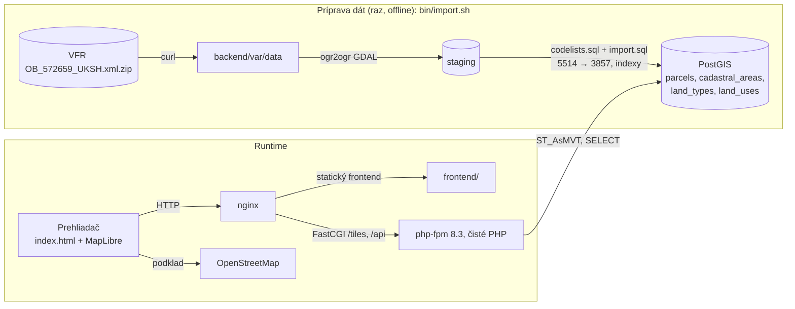

# Mapa parciel okresu Jičín – návrh riešenia

Návrh zodpovedá výslednému riešeniu. Každé rozhodnutie aj s alternatívami je podrobne v [adr.md](adr.md), kroky implementácie v [postup.md](postup.md).

## 1. Čo ideme robiť a prečo

### 1.1 Biznis kontext
Doménou aplikácie je **výkup pozemkov**, typicky poľnohospodársku pôdu, lesy alebo trvalé trávne porasty. V Česku je pôda po reštitúciách a dedičských konaniach veľmi rozdrobená: jedno pole môže tvoriť desiatky parciel s rôznymi vlastníkmi. Práca výkupcu preto vyzerá zhruba takto:

1. **Vytipovať oblasť** (obec, katastrálne územie, okres).
2. **Pozrieť parcely na mape**: aké sú veľké, aký majú druh (orná pôda vs. les vs. zastavaná plocha), ako na seba nadväzujú.
3. **Zistiť vlastníka** parcely z listu vlastníctva v katastri nehnuteľností.
4. **Osloviť vlastníka** a dohodnúť výkup.

Naša aplikácia pokrýva **kroky 1–2** a pri kroku 3 pošle používateľa jedným klikom na oficiálny náhľad katastra (Nahlížení do KN), kde vlastníka nájde. Vlastníci v otvorených dátach nie sú, sú to osobné údaje.

**Prečo je kľúčová plynulosť:** analytik prechádza veľké územia. Ak mapa pri pohľade na celý okres seká alebo sa načítava sekundy, nástroj sa nedá používať. **Stovky tisíc polygónov sa nedajú naraz poslať do prehliadača**, takže to treba riešiť architektonicky.

**Prečo sú dôležité druh pozemku a výmera:** od nich priamo závisí cena a zaujímavosť pozemku pre výkup. Orná pôda sa oceňuje inak ako les a malé parcely bývajú pre výkup menej zaujímavé.

### 1.2 Čo konkrétne postavíme (jednou vetou)
Webovú mapu 5 katastrálnych území obce Jičín, kde vidieť všetky parcely (zafarbené podľa druhu pozemku) a po kliknutí na parcelu sa zobrazí jej číslo, katastrálne územie, výmera, druh a využitie a odkaz do katastra. Celé to beží plynulo vďaka vektorovým dlaždiciam generovaným v PHP z databázy PostGIS.

### 1.3 Slovník pojmov

**Kataster a územie**
| Pojem | Vysvetlenie |
|---|---|
| **Katastr nemovitostí (KN)** | Štátny register nehnuteľností v ČR: parcely, budovy, vlastníci, práva. Vedie ho ČÚZK. |
| **ČÚZK** | Český úřad zeměměřický a katastrální. Poskytuje dáta katastra a mapové služby. |
| **Parcela** | Geometricky určený pozemok s parcelným číslom. Je to základná jednotka, ktorú zobrazujeme. |
| **Parcelné číslo** | Napr. `123/4`: **kmeňové číslo** 123, **pododdelenie** 4. Ak parcelu rozdelili, vzniknú `123/1`, `123/2` … |
| **Stavebná vs. pozemková parcela** | Stavebná („st. 123“) je pod budovou, pozemková („123“) je ostatná pôda. Číslujú sa samostatne, takže v jednom KÚ môže existovať aj „st. 123“, aj „123“. |
| **Katastrálne územie (KÚ)** | Územná jednotka katastra. Parcelné čísla sú jedinečné len v rámci KÚ. Obec môže mať viac KÚ. |
| **Obec / okres** | Administratívne jednotky. Okres Jičín má ~111 obcí a viac KÚ. |
| **Výmera** | Plocha parcely v m² podľa katastra. Nemusí presne sedieť s plochou spočítanou z geometrie. |
| **Druh pozemku** | Číselník KN: orná pôda, chmelnica, vinica, záhrada, ovocný sad, trvalý trávny porast (TTP), lesný pozemok, vodná plocha, zastavaná plocha a nádvorie, ostatná plocha. |
| **Spôsob využitia** | Podrobnejšie určenie, napr. „ostatná plocha – cesta“. |
| **List vlastníctva (LV)** | Dokument s vlastníkmi a právami k nehnuteľnostiam. Nie je v otvorených dátach. |
| **Nahlížení do KN** | Verejná webová aplikácia ČÚZK na prezeranie katastra vrátane LV. Odkážeme na ňu. |

**Dáta ČÚZK**
| Pojem | Vysvetlenie |
|---|---|
| **RÚIAN** | Registr územní identifikace, adres a nemovitostí: základný register s územnými prvkami (štát → okres → obec → KÚ → parcela, budova, adresa). Parcely do neho preberá z katastra. |
| **VFR** | Výmenný formát RÚIAN: XML/GML súbory na stiahnutie, mesačne aktualizované. Súbor obce `OB_<kód>_UKSH` obsahuje **kompletné dáta obce vrátane parciel a ich hraníc**. |
| **INSPIRE** | Smernica EÚ o zdieľaní priestorových dát. ČÚZK podľa nej publikuje aj parcely (téma *Cadastral Parcels*), ale s menej atribútmi. |
| **ISKN** | Informačný systém katastra nehnuteľností, interný zdroj, z ktorého sa plní RÚIAN. |

**Mapové služby a formáty**
| Pojem | Vysvetlenie |
|---|---|
| **WMS** | Web Map Service: server vráti hotový **obrázok** výrezu mapy. Na podklad je to jednoduché, ale nedá sa na neho klikať ani ho štýlovať. |
| **WMTS** | Ako WMS, ale s predrezanými obrázkovými dlaždicami, teda rýchlejšie. |
| **WFS** | Web Feature Service: server vráti **vektorové dáta** (geometrie + atribúty). Pri veľkých územiach je pomalý a obmedzený počtom prvkov. |
| **GML** | Geography Markup Language: XML formát pre geometrie. VFR je GML. |
| **Rastrová dlaždica** | Obrázok 256×256 px pre jeden výrez mapy na danom zoome (napr. OSM podklad). |
| **Vektorová dlaždica (MVT)** | Mapbox Vector Tile: binárny (protobuf) balík **geometrií a atribútov** pre jeden výrez. Prehliadač ho vykreslí sám, takže sa dá štýlovať, klikať a zvýrazňovať. Je to kľúčová technológia pre plynulosť. |
| **Zoom / pyramída dlaždíc** | Zoom 0 = celý svet v 1 dlaždici, každý ďalší zoom ×4 dlaždíc. Adresa dlaždice je `z/x/y`. Okres sa zmestí do pár dlaždíc na z 9, ale na z 16 je ich tisíce. |
| **Generalizácia (simplifikácia)** | Zjednodušenie geometrie (menej bodov) pri malom zoome, keď detail aj tak nevidno. Vďaka tomu sú dlaždice menšie a rýchlejšie. |
| **Choropleth** | Mapa, kde sú plochy zafarbené podľa hodnoty (napr. počet parciel v KÚ). |
| **Ortofoto** | Letecká snímka upravená tak, aby sedela na mapu. Pre výkup je užitočné vidieť, čo na pozemku reálne je. |

**Súradnicové systémy**
| Pojem | Vysvetlenie |
|---|---|
| **S-JTSK (EPSG:5514)** | Český národný súradnicový systém v metroch. ČÚZK v ňom dodáva dáta. |
| **WGS 84 (EPSG:4326)** | Zemepisná šírka a dĺžka (GPS). |
| **Web Mercator (EPSG:3857)** | Projekcia webových máp. Dlaždice z/x/y sú definované v nej, preto do nej dáta transformujeme. |
| **Definičný bod** | Bod vnútri parcely, ktorý dodáva RÚIAN. Hodí sa na popisky a „súradnice parcely“. |

**Technológie**
| Pojem | Vysvetlenie |
|---|---|
| **PostgreSQL + PostGIS** | Relačná databáza s rozšírením pre priestorové dáta (geometrie, priestorové indexy, transformácie, `ST_AsMVT`). |
| **GIST index** | Priestorový index v PostGIS. Umožní rýchlo nájsť parcely v danom výreze bez prechádzania všetkých riadkov. |
| **GDAL / ogr2ogr** | Pozri rozhodnutie 6. |
| **MapLibre GL JS** | Open-source JavaScriptová knižnica na vykresľovanie máp cez WebGL (grafickú kartu). Natívne vie MVT. |
| **php-fpm** | Proces manažér PHP, ktorý obsluhuje viac požiadaviek **paralelne**. Webserver (nginx) mu posiela PHP požiadavky. |
| **Docker Compose** | Spustí všetky služby (DB, PHP, nginx) jedným príkazom rovnako na každom počítači. |

---

## 2. Rozsah a podmienky
- **Rozsah:** 5 KÚ obce Jičín (Jičín, Popovice u Jičína, Robousy, Moravčice, Hubálov), 16 950 parciel. Minimum zadania je KÚ Jičín + 3 ďalšie KÚ. Prečo nie celý okres, je v [ADR-0004](adr.md). Architektúra sa na celý okres dá rozšíriť bez prepisovania.
- **Spúšťanie:** Docker Compose, lokálne netreba PHP ani Node.
- **Backend:** čisté PHP 8.3, žiadny framework.
- **Priority:** plynulosť a výkon, funkčnosť, čitateľný a štruktúrovaný PHP kód.

## 3. Architektúra

**Tok pri používaní:** prehliadač si pýta dlaždice podľa výrezu. Nginx ich pošle do PHP, ktoré ich vygeneruje v PostGIS (do 50 ms) a prehliadač si ich deň pamätá. Po kliknutí na parcelu frontend zoberie `id` z dlaždice a pýta detail z API.

---

## 4. Rozhodnutia (2 možnosti, odporúčaná je prvá)

### 1. Dáta live z ČÚZK, alebo predom stiahnuť?
| | **A) Predom stiahnuť a importovať ✅** | B) Live dotazy na WFS ČÚZK |
|---|---|---|
| Prečo áno | Výkon nezávisí od ČÚZK. Vlastná DB umožní vlastné indexy, generalizáciu a dlaždice. Funguje offline. | Vždy aktuálne dáta; netreba DB ani import. |
| Prečo nie | Dáta zostarnú (VFR vychádza mesačne), dá sa vyriešiť mesačným re-importom. Import trvá pár sekúnd. | WFS má limit prvkov na odpoveď a je pomalý, takže celý okres sa plynulo zobraziť nedá. To je v rozpore s hlavnou požiadavkou. Navyše výpadok ČÚZK znamená nefunkčnú aplikáciu. |

### 2. Ktorý dataset ČÚZK?
| | **A) RÚIAN VFR: súbory obcí `OB_<kód>_UKSH` ✅** | B) INSPIRE Cadastral Parcels (GML po KÚ) |
|---|---|---|
| Prečo áno | Bohaté atribúty: číslo parcely, výmera, **druh pozemku**, **spôsob využitia**, KÚ, definičný bod. Súbory idú po obciach, takže okres = zoznam obcí. GDAL ho vie čítať. | Jednoduchšia schéma, súbor na každé KÚ, denná aktualizácia. |
| Prečo nie | Súbory sú väčšie (obsahujú aj adresy a budovy) a schéma je zložitejšia. | **Chýba druh pozemku a využitie**, pritom presne to výkupcu zaujíma. Zoznam KÚ okresu treba zisťovať inak. |

### 3. Úložisko dát
| | **A) PostgreSQL + PostGIS ✅** | B) SQLite + SpatiaLite |
|---|---|---|
| Prečo áno | `ST_AsMVT` vyrobí vektorovú dlaždicu priamo v SQL. Má GIST indexy a simplifikáciu a je to štandard v GIS praxi. | Jeden súbor, žiadny DB server. |
| Prečo nie | Ďalšia služba, čo pri Dockeri nevadí. | Nevie generovať MVT, takže dlaždice by sa museli predgenerovať iným nástrojom. Rozšírenie sa v PHP zle nastavuje. |

### 4. Ako dostať geometrie do prehliadača (jadro výkonu)
| | **A) Dynamické MVT z PostGIS cez PHP, cache len v prehliadači ✅** | B) Predgenerovaný PMTiles súbor (tippecanoe), servovaný staticky |
|---|---|---|
| Prečo áno | Logika ostáva v PHP backende. Generuje sa len to, kam sa niekto pozrie. Zmena štýlu alebo atribútov nepotrebuje rebuild. Celý tile server je jeden SQL dotaz a krátky controller. | Najrýchlejšie možné servovanie a triviálny runtime. |
| Prečo nie | Každá nová dlaždica stojí dotaz do DB. Pri 5 KÚ je to 12 až 50 ms, takže disková cache by nepriniesla viditeľný rozdiel; pri celom okrese by sa vrátila do hry. | Backend by nerobil takmer nič a logika by sa presunula do externého nástroja. Pribudne ďalší nástroj a pri každej zmene treba celý rebuild. |

Zamietnuté: **celý GeoJSON naraz**. Niekoľko MB na úvod a parsovanie v prehliadači; pri celom okrese stovky MB.

**Stratégia podľa zoomu ([ADR-0011](adr.md)):**
- **Všetky zoomy:** hranice KÚ.
- **z ≥ 10** (minimálny zoom mapy): parcely, geometria zjednodušená na 1 obrazovkový pixel. Celé územie sa zmestí do jednej dlaždice s 321 kB (157 kB gzip). Malé parcely sa nevynechávajú, aby v mape neboli diery.
- **z 16:** posledný zoom, ktorý server generuje; vyššie zoomy MapLibre zväčší (overzoom).
- V dlaždici sú len `id` a `land_type`. Ostatné atribúty sa načítajú až po kliknutí, aby dlaždice ostali malé.

### 5. Backend: čisté PHP, alebo framework?
| | **A) Čisté PHP 8.3 + Composer (PSR-4 autoload), vlastný mini-router ✅** | B) Slim 4 / Symfony |
|---|---|---|
| Prečo áno | Malá aplikácia bez „mágie“: HTTP vrstva a štruktúra sú priamo v kóde a ľahko sa v nich orientuje. Využije moderné PHP: `strict_types`, readonly triedy, first-class callables. | Hotový routing, middleware a DI, menej boilerplate. |
| Prečo nie | Router, error handling a JSON odpovede treba napísať ručne (~100 riadkov). | Framework pridá závislosti a konvencie, ktoré na pár endpointov nie sú potrebné. Symfony je na 4 endpointy zbytočne ťažké. |

### 6. Import dát (a čo je GDAL)
**GDAL** (Geospatial Data Abstraction Library) je open-source knižnica a sada nástrojov, ktorá je „švajčiarsky nožík“ GIS sveta. Číta a zapisuje ~200 formátov priestorových dát (GML, Shapefile, GeoJSON, PostGIS…) a vie transformovať súradnicové systémy. Používa ju QGIS, PostGIS aj väčšina GIS softvéru. Jej nástroj **`ogr2ogr`** prevádza dáta z jedného formátu do druhého. U nás to bude jeden príkaz typu „zober tento VFR súbor a nalej vrstvu Parcely do tabuľky v PostGIS“. GDAL pozná štruktúru RÚIAN VFR, takže zložité GML nemusíme parsovať ručne.

| | **A) Shell skript `bin/import.sh`: ťažkú prácu robí `ogr2ogr`, úpravy SQL ✅** | B) Vlastný streamovaný parser GML v PHP (XMLReader) |
|---|---|---|
| Prečo áno | Overený a rýchly nástroj. Skript len stiahne súbor, spustí `ogr2ogr` do staging schémy a SQL, ktoré v jednej transakcii postaví tabuľky. Celý import trvá asi 2 s. | Viac PHP kódu na ukážku, žiadna závislosť navyše. |
| Prečo nie | Závislosť na GDAL (v Dockeri je to `apt-get install gdal-bin` v PHP image) a na bashe na hoste. | Parsovanie GML 3.2 geometrií (multipolygóny, diery, oblúky) je pracné a chybové. Na 4–12 h je to zlý obchod. |

Zvažovaný bol aj PHP CLI príkaz, ktorý by `ogr2ogr` riadil z PHP. Bol by to len obal okolo tých istých príkazov ([ADR-0006](adr.md)).

### 7. Mapová knižnica
| | **A) MapLibre GL JS ✅** | B) Leaflet (+ VectorGrid) |
|---|---|---|
| Prečo áno | Kreslí cez WebGL na grafickej karte, takže desaťtisíce polygónov idú plynulo. Natívne MVT, filtrovanie a zvýraznenie podľa `id` prvku, farby podľa atribútu, bez API kľúča. | Najjednoduchšie API, veľa návodov. |
| Prečo nie | Štýlová špecifikácia (výrazy) sa chvíľu učí. | Kreslí cez Canvas/SVG v hlavnom vlákne, takže pri tisícoch polygónov seká. Výkon je pritom hlavné kritérium. |

### 8. Frontend: framework, alebo nie?
**Kľúčový fakt:** na výkone mapy framework **prakticky nič nemení**. Mapu kreslí MapLibre cez WebGL, mimo React/Vue render cyklu. Framework by riadil len panel a legendu, teda pár desiatok DOM prvkov. Rozhoduje teda **boilerplate** a to, či spustenie potrebuje Node a build.

| | **A) Jeden `frontend/index.html`, MapLibre z CDN, čisté JS ✅** | B) React + TypeScript + Vite + `react-map-gl/maplibre` |
|---|---|---|
| Prečo áno | Žiadny build, `node_modules` ani Node na spustenie; nginx súbor servuje priamo. Pri jednej obrazovke s panelom a legendou je to približne 150 riadkov JS. | Deklaratívne `<Map><Source><Layer/></Source></Map>`, typy a komponenty. Najmenej kódu pri mnohých funkciách (vyhľadávanie, multi-výber, export). |
| Prečo nie | Bez typov a komponentov, takže pri väčšom UI by sa súbor ťažko udržiaval. | Build krok, závislosti a ďalší kontajner alebo inštrukcie na spustenie. Pri jednej obrazovke je to viac boilerplate ako samotnej logiky. |

Pri pribúdaní funkcií by sa oplatilo prejsť na Vite + TypeScript ([ADR-0013](adr.md)).

### 9. Mapový podklad
**Výkon:** podklad sú v oboch prípadoch rastrové dlaždice z CDN, takže výkon je **prakticky rovnaký**.
**Boilerplate:** Mapy.com cez REST API je v MapLibre **jedna URL**, rovnako ako OSM (`https://api.mapy.com/v1/maptiles/outdoor/256/{z}/{x}/{y}?apikey=…`). Starý Mapy.cz JS SDK (SMap) **nepoužijeme**, je to samostatná mapová knižnica, ktorá by nahradila MapLibre.
**Kvalita:** Mapy.com má pre ČR lepšiu kartografiu (turistická mapa, poľné cesty, názvy tratí) a **vlastné letecké snímky do z 20**. Pre výkupcu je to reálne lepšie.

| | **A) OpenStreetMap ✅** | B) Mapy.com (ak je v `.env` kľúč) s fallbackom na OSM a prepínačom na ortofoto ČÚZK |
|---|---|---|
| Prečo áno | Žiadna registrácia, API kľúč ani konfigurácia, jedna URL v štýle mapy. Aplikáciu spustí ktokoľvek, aj spoločne na pohovore. | Najlepšia mapa pre ČR a letecké snímky, ktoré výkupcovi ukážu, čo na pozemku reálne je. |
| Prečo nie | V ČR slabší v detailoch a tile server OSM nie je určený na produkčnú záťaž. | Treba registráciu a dodržať atribúciu (logo Mapy.com). Kľúč je viditeľný vo frontende a prepínač podkladov je ďalší kód. |

Mapy.com, ortofoto a prekryv katastrálnej mapy (WMS ČÚZK) sú v zozname ďalších krokov ([ADR-0014](adr.md)).

### 10. Webserver
| | **A) nginx + php-fpm ✅** | B) `php -S` (vstavaný server) |
|---|---|---|
| Prečo áno | Mapa naraz žiada 10–20 dlaždíc a php-fpm ich obslúži **paralelne**. nginx servuje frontend bez PHP a gzipuje dlaždice aj JSON. | Nula konfigurácie. |
| Prečo nie | Pribudne kontajner a jeden nginx config. | Je **jednovláknový**, takže dlaždice by stáli v rade a mapa by sekala. Dobrá poznámka do zápisníka. |

---

## 5. Features

**Hotové**
1. Mapa celého importovaného územia (5 KÚ) s plynulým zoomom a posunom, parcely viditeľné už pri úvodnom pohľade.
2. Klik na parcelu ju zvýrazní a otvorí bočný panel (na mobile spodný): parcelné číslo (stavebné s „st.“), KÚ (názov + kód), obec, výmera (m², od 1 ha aj ha), druh pozemku, spôsob využitia a odkaz na Nahlížení do KN.
3. README a zápisník.

**Hotové navyše**
1. **Farba podľa druhu pozemku** + legenda s vypínaním druhov. Je to najrelevantnejšie pre výkup.

**Ďalšie kroky (v poradí priority)**
1. **Celý okres** (111 obcí) s agregovanými KÚ na malých zoomoch.
2. **Vyhľadávanie**: KÚ + parcelné číslo (napr. „Jičín, 1234/5“), potom zoom na parcelu.
3. **Permalink**: stav mapy a vybraná parcela v URL, dá sa poslať kolegovi.
4. **Prepínač podkladov** (OSM / Mapy.com / ortofoto) + prekryv katastrálnej mapy (WMS ČÚZK).
5. **Multi-výber** parciel so súčtom výmery a **exportom do CSV/GeoJSON**: „balík na výkup“.
6. **BPEJ** (bonita pôdy) v detaile parcely.
7. **Choropleth KÚ** na malých zoomoch (počet parciel, podiel ornej pôdy).
8. **Tooltip** s číslom parcely pri prechode myšou.

